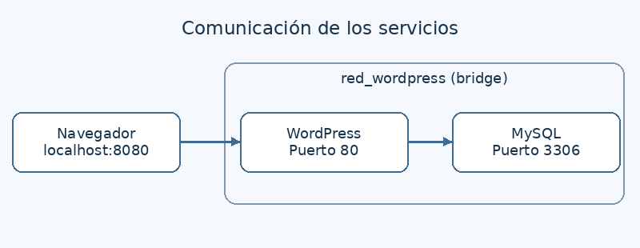
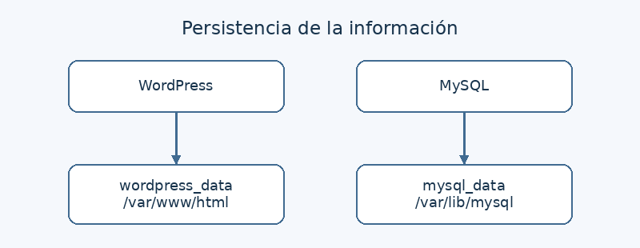
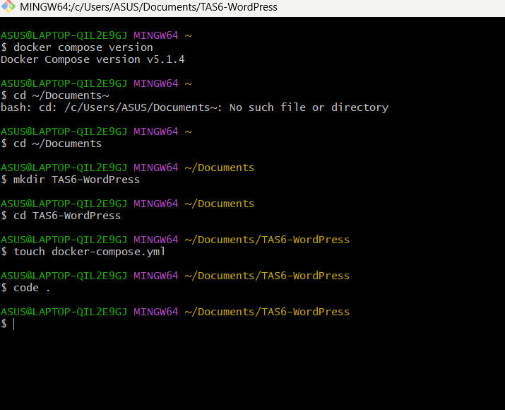
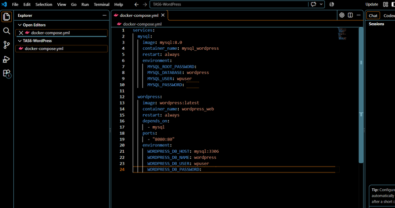
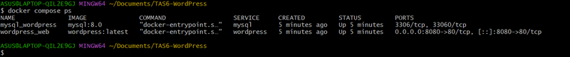
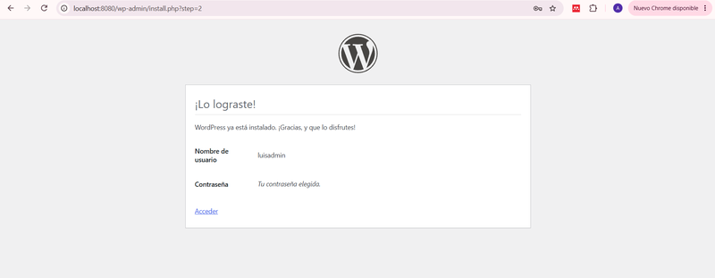
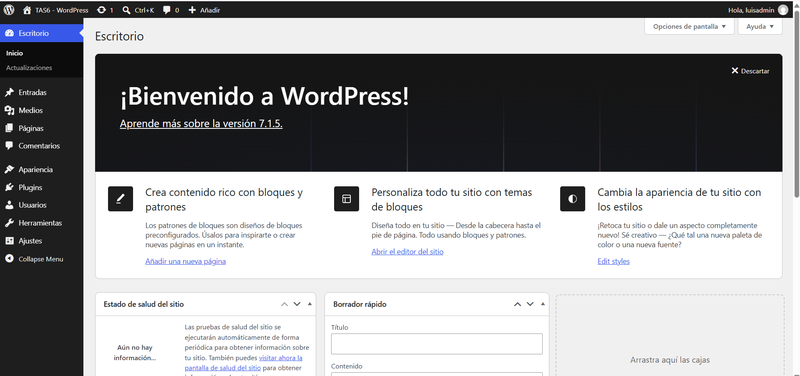

# TAS6 – WordPress con Docker Compose

**Instituto de Tecnologías Sudamericano**  
**Carrera:** Desarrollo de Software  
**Estudiante:** Luis Illescas

## 1. Título

Despliegue de WordPress y MySQL mediante Docker Compose.

## 2. Tiempo de duración

120 minutos (2 horas).

## 3. Fundamentos

Docker es una herramienta que permite ejecutar aplicaciones dentro de contenedores. Un contenedor reúne los elementos que necesita un programa para funcionar y mantiene su entorno separado del de otras aplicaciones. A diferencia de una máquina virtual tradicional, los contenedores comparten el núcleo del sistema que los ejecuta. En Windows, Docker Desktop proporciona el entorno necesario para trabajar con contenedores Linux. Esto facilita instalar servicios sin tener que configurar cada programa directamente en el sistema operativo de la computadora.

Una imagen de Docker contiene los archivos y las instrucciones necesarios para crear un contenedor. En esta práctica utilicé una imagen de MySQL y otra de WordPress. Docker Compose permite definir ambos servicios dentro de un archivo YAML. En ese archivo se pueden indicar las imágenes, los nombres de los contenedores, las variables de entorno, los puertos, las redes y los volúmenes. Así se evita tener que iniciar cada servicio por separado con comandos largos.

WordPress es un sistema de gestión de contenidos que permite administrar sitios web desde un navegador. Para funcionar necesita una base de datos donde guardar información como usuarios, entradas y configuraciones. MySQL cumple esa función en esta práctica. Los datos de conexión de WordPress deben coincidir con los que se configuraron en MySQL; de lo contrario, la aplicación no podrá acceder a la base de datos.



*Figura 3-1. Comunicación entre el navegador, WordPress y MySQL. Elaboración propia.*

La red de tipo bridge permite que los dos contenedores se comuniquen utilizando el nombre del servicio. WordPress se conecta a MySQL por el puerto 3306 dentro de la red. Para entrar desde el navegador se utiliza el puerto 8080 de la computadora, que se relaciona con el puerto 80 del contenedor de WordPress. No es necesario publicar el puerto de MySQL para que WordPress pueda utilizarlo.

Los volúmenes sirven para conservar información fuera de la capa de escritura del contenedor. En este caso se configuró un volumen para los datos de MySQL y otro para los archivos de WordPress. Si se recrean los contenedores sin eliminar los volúmenes, los datos pueden seguir disponibles. Entender estos conceptos me ayudó a comprender por qué la aplicación necesita dos servicios y cómo Docker Compose organiza su funcionamiento.



*Figura 3-2. Relación entre los contenedores y sus volúmenes. Elaboración propia.*

## 4. Conocimientos previos

- Comandos básicos de terminal: `cd`, `mkdir` y `touch`.
- Manejo del navegador web.
- Conceptos básicos de imágenes y contenedores Docker.
- Estructura de archivos YAML y conceptos básicos de bases de datos.

## 5. Objetivos a alcanzar

- Implementar los servicios WordPress y MySQL mediante Docker Compose.
- Configurar las credenciales y la comunicación entre los servicios mediante una red.
- Configurar volúmenes para conservar la información.
- Verificar el funcionamiento de WordPress y acceder a su panel de administración.

## 6. Equipo necesario

- Computadora con Windows y conexión a Internet.
- Docker Desktop y Docker Compose v5.1.4.
- Git Bash y Visual Studio Code.
- Navegador Google Chrome.

## 7. Material de apoyo

- Enunciado de la actividad TAS6 de la asignatura.
- [Documentación de Docker Compose](https://docs.docker.com/compose/).
- [Documentación de WordPress](https://wordpress.org/documentation/).
- [Documentación de MySQL 8.0](https://dev.mysql.com/doc/refman/8.0/en/).

## 8. Procedimiento

### Paso 1. Creación del archivo docker-compose.yml

Primero abrí Docker Desktop y utilicé Git Bash para comprobar que Docker Compose estaba disponible. Después creé una carpeta para la práctica y dentro de ella el archivo `docker-compose.yml`, que abrí con Visual Studio Code.

```bash
docker compose version
cd ~/Documents
mkdir TAS6-WordPress
cd TAS6-WordPress
touch docker-compose.yml
code .
```



*Figura 8-1. Preparación de la carpeta y creación del archivo.*

### Paso 2. Configuración del servicio MySQL

Dentro del archivo definí el servicio MySQL utilizando la imagen `mysql:8.0`. Le asigné el nombre `mysql_wordpress` al contenedor y configuré la base de datos `wordpress`, el usuario `wpuser` y las contraseñas necesarias para acceder a la base de datos.


*Figura 8-2. Configuración del servicio MySQL.*

### Paso 3. Configuración del servicio WordPress

En el mismo archivo agregué el servicio WordPress. Utilicé la imagen `wordpress:latest` y configuré la conexión con MySQL mediante el nombre del servicio y el puerto 3306. También coloqué las mismas credenciales de la base de datos y asigné el puerto 8080 para abrir WordPress desde el navegador.



*Figura 8-3. Configuración de WordPress y su conexión con MySQL.*

### Paso 4. Definición de la red

Para que los dos contenedores pudieran comunicarse, creé una red llamada `red_wordpress` de tipo `bridge`. Agregué ambos servicios a esta red, de manera que WordPress pudiera conectarse a MySQL utilizando su nombre de servicio.


*Figura 8-4. Red compartida por los dos servicios.*

### Paso 5. Configuración de los volúmenes

Agregué dos volúmenes: `mysql_data` para guardar los datos de MySQL y `wordpress_data` para conservar los archivos de WordPress. De esta manera, la información queda almacenada fuera de la capa de escritura de los contenedores y puede mantenerse al recrearlos, siempre que se conserven los volúmenes.


*Figura 8-5. Volúmenes y rutas de almacenamiento.*

El archivo final quedó con la siguiente estructura. Las contraseñas se sustituyeron por marcadores en este informe por seguridad; para ejecutar el archivo se deben reemplazar por valores propios y hacer coincidir la contraseña del usuario MySQL con la de conexión de WordPress.

```yaml
services:
  mysql:
    image: mysql:8.0
    container_name: mysql_wordpress
    restart: always
    environment:
      MYSQL_ROOT_PASSWORD: "<CONTRASEÑA_ROOT>"
      MYSQL_DATABASE: wordpress
      MYSQL_USER: wpuser
      MYSQL_PASSWORD: "<CONTRASEÑA_MYSQL>"
    networks:
      - red_wordpress
    volumes:
      - mysql_data:/var/lib/mysql

  wordpress:
    image: wordpress:latest
    container_name: wordpress_web
    restart: always
    depends_on:
      - mysql
    ports:
      - "8080:80"
    environment:
      WORDPRESS_DB_HOST: mysql:3306
      WORDPRESS_DB_NAME: wordpress
      WORDPRESS_DB_USER: wpuser
      WORDPRESS_DB_PASSWORD: "<CONTRASEÑA_MYSQL>"
    networks:
      - red_wordpress
    volumes:
      - wordpress_data:/var/www/html

networks:
  red_wordpress:
    driver: bridge

volumes:
  mysql_data:
  wordpress_data:
```

### Paso 6. Ejecución de los servicios y verificación desde el navegador

Una vez terminado el archivo, guardé los cambios y regresé a Git Bash. Primero revisé la configuración con `docker compose config`. Como no aparecieron errores, ejecuté los servicios con el siguiente comando:

```bash
docker compose config
docker compose up -d
```

Docker creó la red, los volúmenes e inició los dos contenedores.


*Figura 8-6. Creación e inicio de los servicios.*

Después comprobé el estado de los contenedores:

```bash
docker compose ps
```

Los dos aparecieron con el estado `Up`, lo que me permitió comprobar que estaban en ejecución.



*Figura 8-7. Estado de los contenedores MySQL y WordPress.*

Abrí el navegador e ingresé a `http://localhost:8080`. Apareció la pantalla de selección de idioma de WordPress, por lo que pude continuar con la instalación.


*Figura 8-8. Pantalla inicial de WordPress.*

### Paso 7. Instalación inicial y acceso al panel de administración

Seleccioné el idioma español y completé el formulario con el título del sitio, un usuario administrador, una contraseña y mi correo electrónico. Después presioné el botón Instalar WordPress y apareció el mensaje que confirmaba que la instalación había terminado correctamente.



*Figura 8-9. Confirmación de la instalación de WordPress.*

Finalmente, inicié sesión con el usuario que había creado y pude ingresar al escritorio de administración del sitio TAS6 - WordPress.



*Figura 8-10. Acceso al escritorio de administración de WordPress.*

## 9. Resultados esperados

Se esperaba que los dos contenedores quedaran en ejecución y que WordPress pudiera conectarse con MySQL. Al realizar la práctica, ambos servicios aparecieron con el estado `Up`. También pude instalar WordPress desde el navegador e ingresar al escritorio de administración del sitio TAS6 - WordPress.


*Figura 9-1. Estado final de los contenedores.*


*Figura 9-2. Resultado final: acceso al panel de administración.*

Los volúmenes quedaron configurados para conservar la información, aunque no se realizó una prueba de recreación de contenedores. Con esta práctica comprendí cómo se pueden organizar varios servicios en un solo archivo y cómo se relacionan las redes, los puertos y el almacenamiento.

## 10. Bibliografía

Docker, Inc. (s. f.). *Docker Compose*. https://docs.docker.com/compose/

Docker, Inc. (s. f.). *Volumes*. https://docs.docker.com/engine/storage/volumes/

Oracle. (s. f.). *MySQL 8.0 reference manual*. https://dev.mysql.com/doc/refman/8.0/en/

WordPress.org. (s. f.). *Documentation*. https://wordpress.org/documentation/
