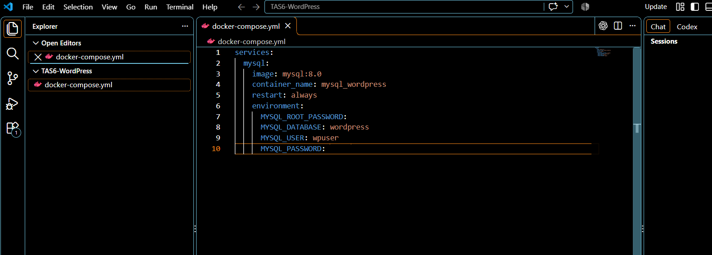
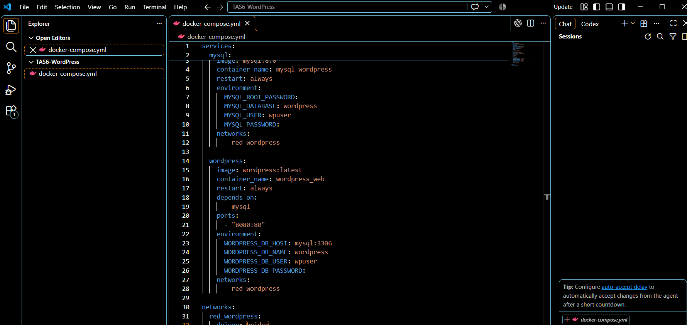
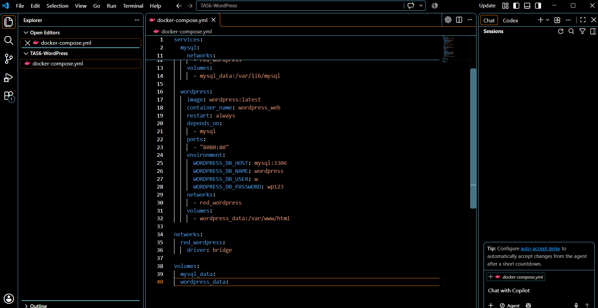
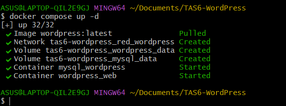
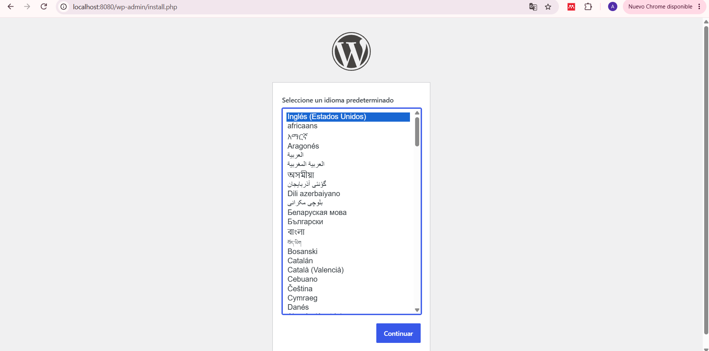

# TAS6 – WordPress con Docker Compose

**Instituto de Tecnologías Sudamericano**  
**Carrera:** Desarrollo de Software  
**Estudiante:** Luis Illescas

## Introducción

En esta práctica trabajé con Docker Compose para instalar WordPress y MySQL en mi computadora. La idea fue levantar los dos servicios desde un mismo archivo, conectarlos mediante una red y configurar volúmenes para conservar la información. Al finalizar pude ingresar al escritorio de WordPress desde el navegador.

## Objetivo

Desplegar WordPress y MySQL mediante Docker Compose, establecer la comunicación entre ambos servicios y completar la instalación inicial de WordPress.

## Desarrollo de la práctica

### 1. Creación del archivo docker-compose.yml

Primero abrí Docker Desktop y utilicé Git Bash para comprobar que Docker Compose estaba disponible. Después creé una carpeta para la práctica y dentro de ella el archivo `docker-compose.yml`, que abrí con Visual Studio Code.

```bash
docker compose version
cd ~/Documents
mkdir TAS6-WordPress
cd TAS6-WordPress
touch docker-compose.yml
code .
```


*Figura 1. Preparación de la carpeta y creación del archivo.*

### 2. Configuración del servicio MySQL

Dentro del archivo definí el servicio MySQL utilizando la imagen `mysql:8.0`. Le asigné el nombre `mysql_wordpress` al contenedor y configuré la base de datos `wordpress`, el usuario `wpuser` y las contraseñas necesarias para acceder a la base de datos.



*Figura 2. Configuración del servicio MySQL.*

### 3. Configuración del servicio WordPress

En el mismo archivo agregué el servicio WordPress. Utilicé la imagen `wordpress:latest` y configuré la conexión con MySQL mediante el nombre del servicio y el puerto 3306. También coloqué las mismas credenciales de la base de datos y asigné el puerto 8080 para abrir WordPress desde el navegador.


*Figura 3. Configuración de WordPress y su conexión con MySQL.*

### 4. Definición de la red

Para que los dos contenedores pudieran comunicarse, creé una red llamada `red_wordpress` de tipo `bridge`. Agregué ambos servicios a esta red, de manera que WordPress pudiera conectarse a MySQL utilizando su nombre de servicio.



*Figura 4. Red compartida por los dos servicios.*

### 5. Configuración de los volúmenes

Agregué dos volúmenes: `mysql_data` para guardar los datos de MySQL y `wordpress_data` para conservar los archivos de WordPress. De esta manera, la información queda almacenada fuera de la capa de escritura de los contenedores y puede mantenerse al recrearlos, siempre que se conserven los volúmenes.



*Figura 5. Volúmenes y rutas de almacenamiento.*

El archivo final quedó con la siguiente estructura. Las contraseñas se sustituyeron por marcadores en este informe por seguridad; para ejecutar el archivo se deben reemplazar por valores propios y hacer coincidir la contraseña del usuario MySQL con la de conexión de WordPress.

```yaml
services:
  mysql:
    image: mysql:8.0
    container_name: mysql_wordpress
    restart: always
    environment:
      MYSQL_ROOT_PASSWORD: "<CONTRASEÑA_ROOT>"
      MYSQL_DATABASE: wordpress
      MYSQL_USER: wpuser
      MYSQL_PASSWORD: "<CONTRASEÑA_MYSQL>"
    networks:
      - red_wordpress
    volumes:
      - mysql_data:/var/lib/mysql

  wordpress:
    image: wordpress:latest
    container_name: wordpress_web
    restart: always
    depends_on:
      - mysql
    ports:
      - "8080:80"
    environment:
      WORDPRESS_DB_HOST: mysql:3306
      WORDPRESS_DB_NAME: wordpress
      WORDPRESS_DB_USER: wpuser
      WORDPRESS_DB_PASSWORD: "<CONTRASEÑA_MYSQL>"
    networks:
      - red_wordpress
    volumes:
      - wordpress_data:/var/www/html

networks:
  red_wordpress:
    driver: bridge

volumes:
  mysql_data:
  wordpress_data:
```

### 6. Ejecución de los servicios y verificación desde el navegador

Una vez terminado el archivo, guardé los cambios y regresé a Git Bash. Primero revisé la configuración con `docker compose config`. Como no aparecieron errores, ejecuté los servicios con el siguiente comando:

```bash
docker compose config
docker compose up -d
```

Docker creó la red, los volúmenes e inició los dos contenedores.



*Figura 6. Creación e inicio de los servicios.*

Después comprobé el estado de los contenedores:

```bash
docker compose ps
```

Los dos aparecieron con el estado `Up`, lo que me permitió comprobar que estaban en ejecución.


*Figura 7. Estado de los contenedores MySQL y WordPress.*

Abrí el navegador e ingresé a `http://localhost:8080`. Apareció la pantalla de selección de idioma de WordPress, por lo que pude continuar con la instalación.



*Figura 8. Pantalla inicial de WordPress.*

### 7. Instalación inicial y acceso al panel de administración

Seleccioné el idioma español y completé el formulario con el título del sitio, un usuario administrador, una contraseña y mi correo electrónico. Después presioné el botón Instalar WordPress y apareció el mensaje que confirmaba que la instalación había terminado correctamente.


*Figura 9. Confirmación de la instalación de WordPress.*

Finalmente, inicié sesión con el usuario que había creado y pude ingresar al escritorio de administración del sitio TAS6 - WordPress.


*Figura 10. Acceso al escritorio de administración de WordPress.*

## Resultados

Logré ejecutar WordPress y MySQL desde un solo archivo Docker Compose. Los dos contenedores quedaron en funcionamiento, conectados a una misma red y con sus respectivos volúmenes configurados. También pude completar la instalación de WordPress e ingresar a su panel de administración desde el navegador. No realicé una prueba de recreación de contenedores para comprobar la persistencia, ya que no formaba parte del procedimiento solicitado.

## Conclusión

Con esta práctica aprendí que Docker Compose facilita el trabajo cuando una aplicación necesita varios servicios para funcionar. En este caso entendí cómo WordPress se conecta con MySQL y por qué es importante que los datos de conexión coincidan. También comprendí para qué sirven las redes y los volúmenes dentro de Docker. Lo que más me ayudó a comprobar que todo estaba bien configurado fue poder abrir WordPress desde el navegador, instalarlo e ingresar a su escritorio de administración.
